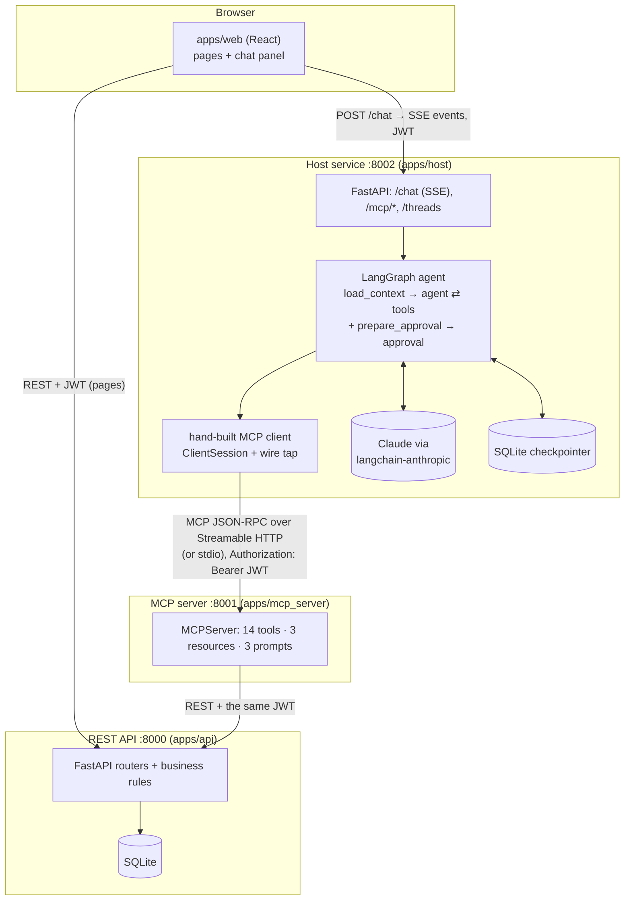
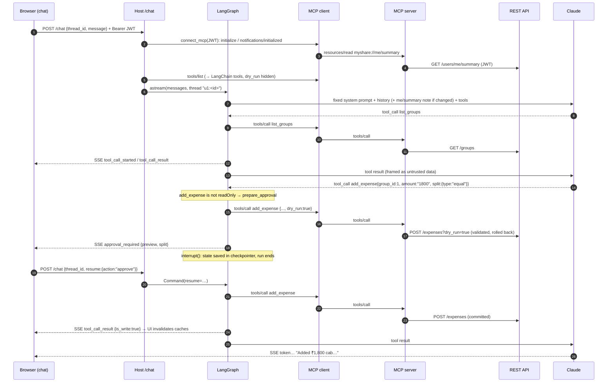
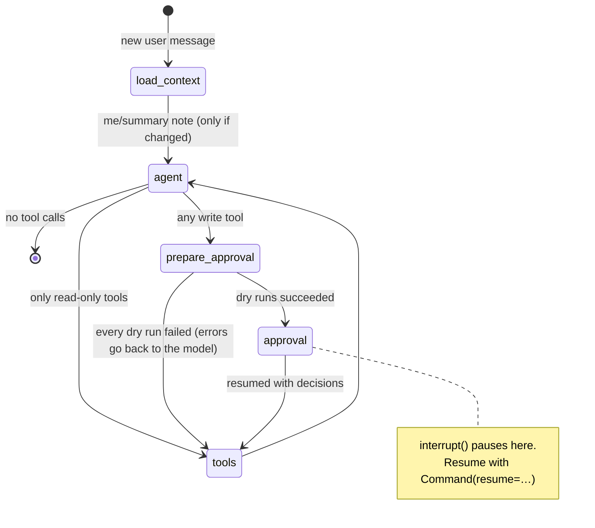
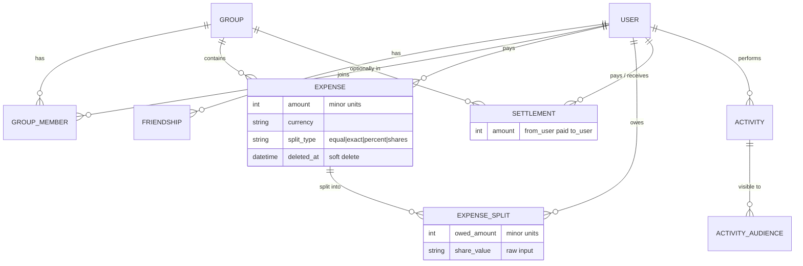

# MyShare architecture

MyShare has four processes. Each one has a single job, and the arrows below are the only ways they talk to each other.



| Component | Owns | Knows nothing about |
|---|---|---|
| **REST API** (`apps/api`) | Data, money math, authorization, activity log | MCP, LLMs |
| **MCP server** (`apps/mcp_server`) | Describing MyShare as tools/resources/prompts; money formatting for models | LLMs, the database, which host is calling |
| **Host** (`apps/host`) | The LLM, the conversation, approval policy, guardrails, persistence | SQL, business rules |
| **Web** (`apps/web`) | Pages, design system, chat UI | MCP wire details (it only sees host events) |

The web app calls the REST API directly for normal pages, and calls the host for the chat. When a chat action changes data, the host emits `tool_call_result {is_write: true}`. The browser then invalidates its TanStack Query caches, so the page behind the chat refreshes.

## Request flow: "Add ₹1,800 for cab to Goa Trip, split equally"



## LangGraph state machine (`apps/host/myshare_host/graph/`)



State (`graph/state.py`): `messages`, `user_context`, `gated_tools`, `pending` (approval cards), `decisions`. Live objects (the MCP connection, the LLM with tools bound, tool definitions) go in `HostContext`, which LangGraph passes as `runtime.context`. That context is **never checkpointed**: a resumed thread gets a fresh connection using the current user's token.

## Data model (`apps/api/myshare_api/models.py`)



**Balances are never stored.** `services/balances.py` builds a pairwise ledger (debtor, creditor, currency) → amount from live expenses and settlements, and answers every question from it: per friend, per group member, and overall. `services/simplify.py` turns group net balances into the fewest transfers using greedy max-creditor/max-debtor matching. `services/splits.py` does the split math in integer minor units; leftover units go to the first participants with non-zero weight.

## Decisions and deviations from the spec

| # | Decision | Why |
|---|---|---|
| 1 | Python packages are named `myshare_api`, `myshare_mcp`, `myshare_host` and `myshare_shared` (inside `apps/<name>/`). The seed command is `uv run python -m myshare_api.seed`, not `apps.api.seed`. | Each uv workspace member must be an importable package. A top-level `apps` namespace across members is fragile. |
| 2 | **MCP SDK 2.3.0** (spec text predates it): `FastMCP` → `MCPServer`, snake_case attributes, `httpx2` for HTTP. The SDK's new protocol revision (2026-07-28) adds a `server/discover` handshake, and the high-level `mcp.Client` uses it by default. | The host deliberately uses `ClientSession` + `initialize()` (protocol `2025-11-25`) so the classic lifecycle is visible. The Inspector and Claude Desktop speak it too. |
| 3 | Static resources can't receive a `Context` in SDK v2, so the per-user token is read by **server middleware** that stores HTTP headers in a `ContextVar` (`mcp_server/auth.py`). | It's the one mechanism that works for tools, resources, and prompts alike. |
| 4 | Added `Friendship` and `ActivityAudience` tables. | Friends need storage. Activity visibility becomes a simple join. |
| 5 | Write endpoints accept `?dry_run=true` (validate, build the response, roll back). Write MCP tools expose `dry_run`. The host hides it from the model and uses it to render approval cards. | The card shows exactly what will happen, computed by the source of truth. Invalid actions never reach a human: the error goes back to the model instead. |
| 6 | An extra graph node, `prepare_approval`, runs before `approval`. | `interrupt()` re-runs its node on resume, so slow, side-effect-free dry runs live in their own node. |
| 7 | "Edit" on an approval card sends **feedback text** ("make it ₹1,500"), which the model uses to propose a corrected call. That call needs approval again. | Simpler and safer than letting the browser rewrite raw tool arguments. |
| 8 | One MCP connection per chat request (HTTP: one `initialize` per turn; stdio: one subprocess per turn). Resource reads are cached per connection. | The simplest correct per-user isolation. Pooling is an exercise. |
| 9 | Threads are namespaced as `u<user_id>:<thread_id>`. | One user can't load or resume another user's conversation by guessing an id. |
| 10 | Approval policy: approve anything **not** annotated `readOnlyHint: true`, or anything `destructiveHint: true`. | Annotations are hints; the safe default for an unknown tool is "ask". |
| 11 | Adding someone to a group makes all members friends. Removing a member with a non-zero group balance is refused. | Matches Splitwise; keeps 1:1 balances meaningful. |
| 12 | Currency: one per group. Non-group expenses use the user's default currency (INR). Balances are reported per currency. | The spec allows a single currency per group. Mixing currencies without conversion would be wrong. |
| 13 | `resolve_person` / `GET /people/resolve` only searches people the caller already knows (friends and co-members). | Prevents user enumeration through the assistant. |
| 14 | No Alembic: `Base.metadata.create_all` at startup, and `make seed` rebuilds. | The spec marks Alembic optional; this keeps the learning project small. |
| 15 | The web app uses **npm** and **ESLint** (the current Vite template ships oxlint; replaced to match the spec). | As specified. |
| 16 | `scripts/fake_host.py` / `make dev-offline`: the real host with a keyword stand-in for the LLM. | Lets you develop the chat UI, run `make e2e`, and demo MCP without an API key. Never used in tests of the real model path. |
| 17 | Default model `claude-sonnet-5-5` (`MODEL_NAME`). | The current Claude Sonnet. |
| 18 | Tool results go to the model wrapped in `<tool_result trust="untrusted-data">`; the system prompt explains the wrapper. | Prompt-injection mitigation (see MCP_EXPLAINED §6). |
| 19 | `DELETE /groups/{id}` is a hard delete (group, expenses, settlements, memberships), allowed for any member but only when every member's group balance is zero. Activity entries are kept but detached from the deleted rows. Not exposed as an MCP tool. | Deleting open balances would silently erase debts. Groups have no `deleted_at` column, and adding one needs a migration this project doesn't have. |

## Where things live

```
apps/api/myshare_api/      main.py · models.py · schemas.py · deps.py (auth) · routers/* · services/{splits,balances,simplify,common}.py · seed.py
apps/mcp_server/myshare_mcp/  server.py (tools/resources/prompts) · auth.py · api_client.py · views.py · __main__.py
apps/host/myshare_host/    mcp_client/{connection,tools,wire}.py · graph/{state,nodes,builder,prompts}.py · service.py · main.py · cli.py
apps/web/src/              pages/* · components/{ui,layout}/* · chat/{store,model,sse,ChatLauncher,ApprovalCard,ToolChip,Composer,CapabilitiesDrawer}.tsx · lib/*
packages/shared/myshare_shared/money.py   decimal ↔ minor units, formatting
tests/{api,mcp,host}/      pytest suites   ·   apps/web/src/**/*.test.ts(x)  Vitest
scripts/                   e2e_demo.py · injection_demo.py · smoke_host.py · fake_host.py · get_token.py
```
