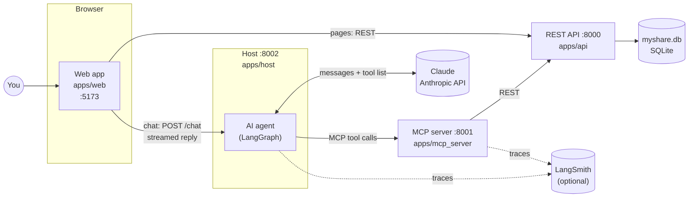
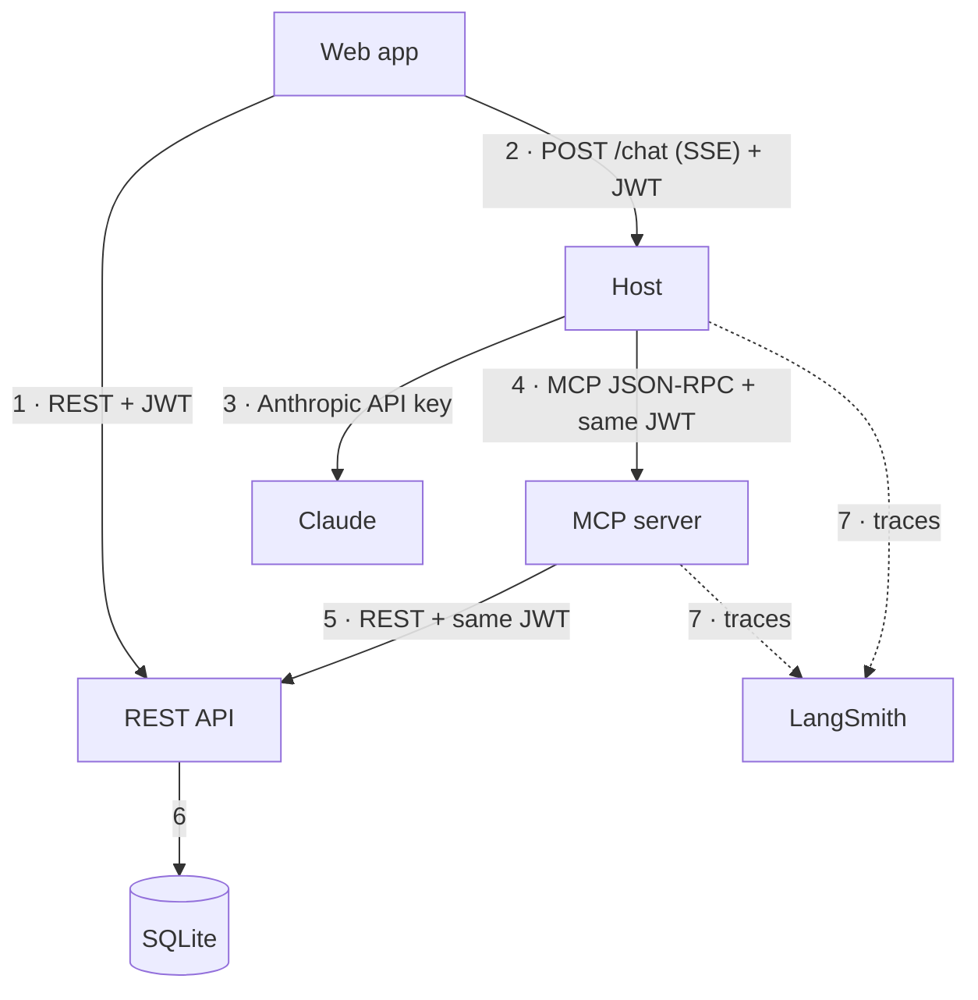
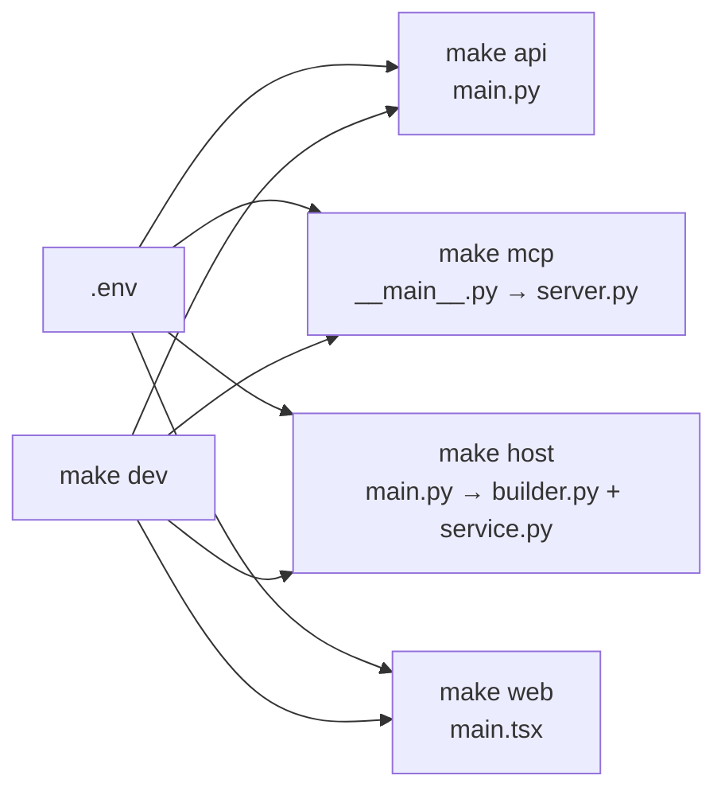
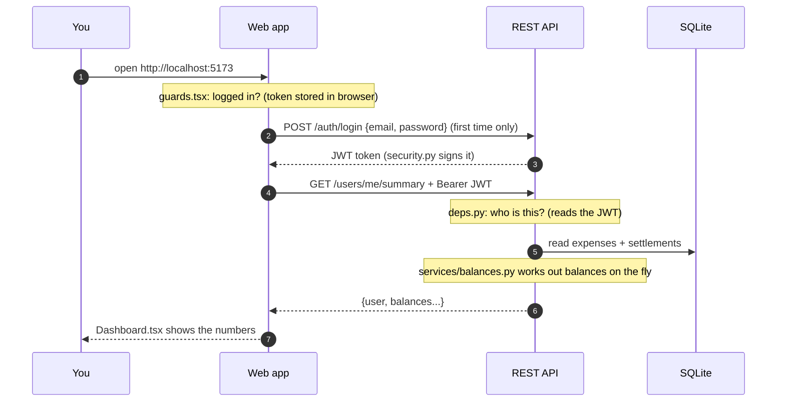
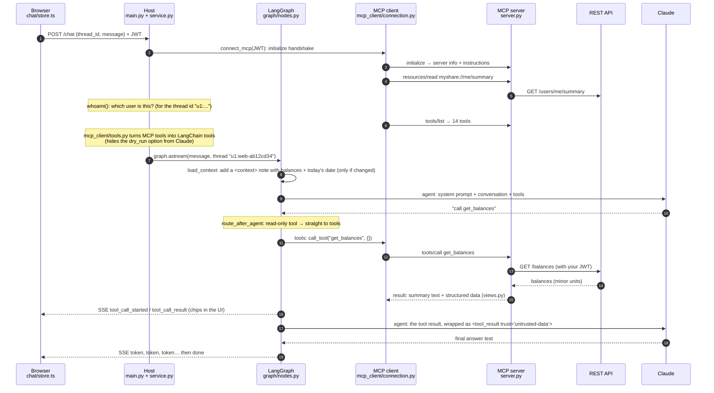
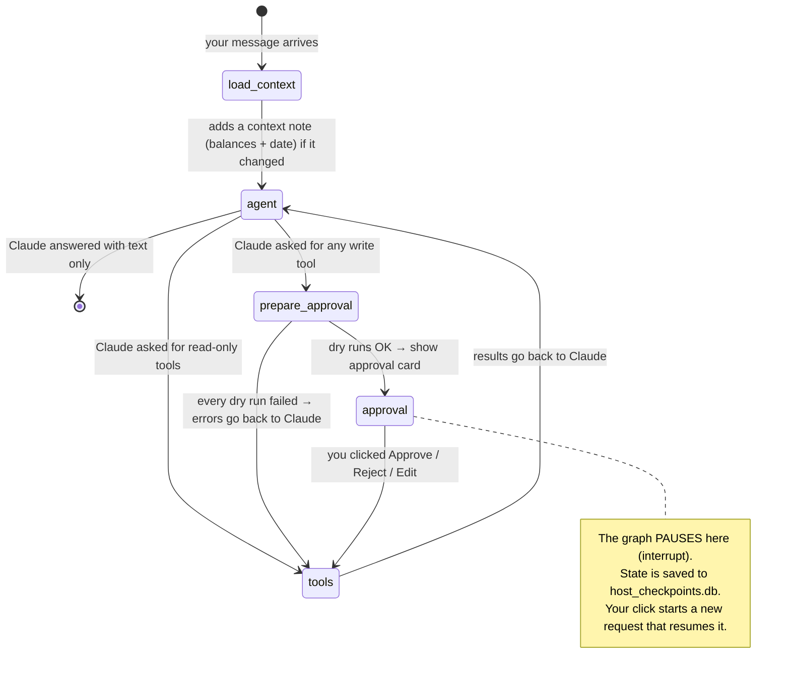
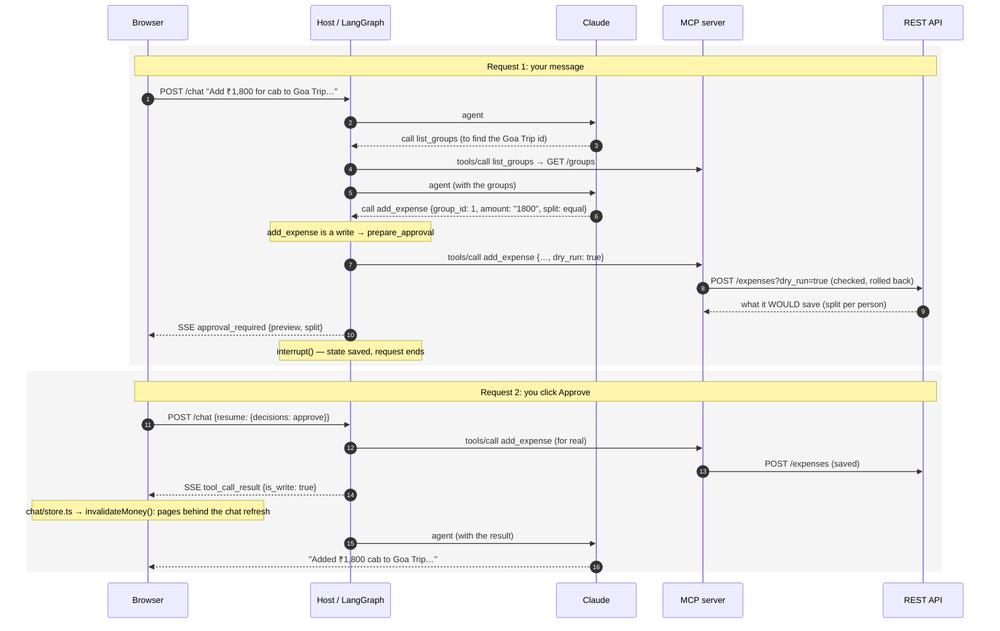
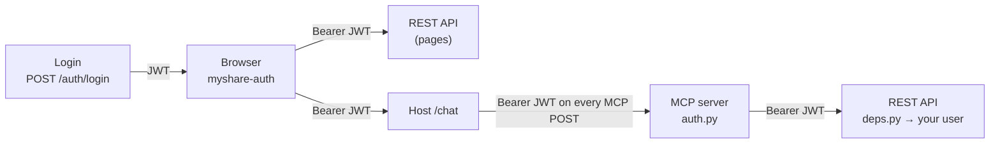
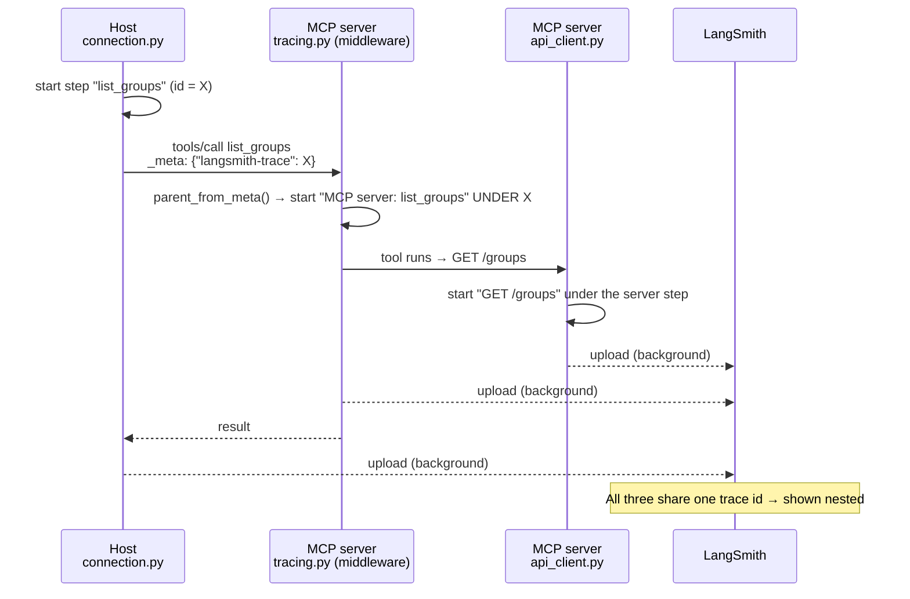
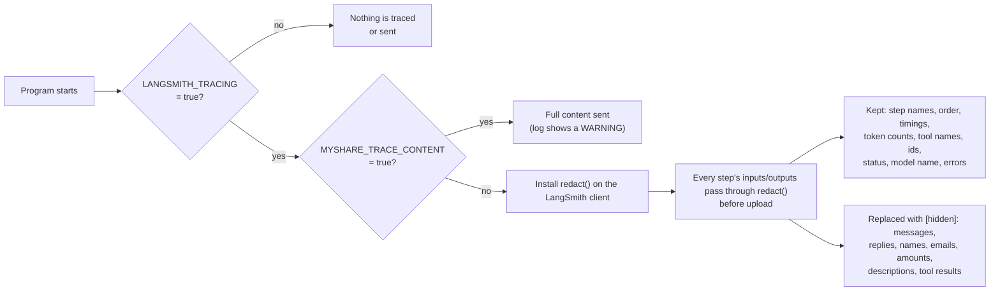

# How MyShare works, from input to output

This guide explains how MyShare works as a system: which programs run, which files each one uses, who calls whom, and what happens between typing a message and seeing the answer. The last part covers LangSmith tracing.

It's written to be turned into diagrams and slides. Every diagram is [Mermaid](https://mermaid.js.org/), which GitHub renders directly and tools like mermaid.live can export as images. The tables are structured so they can become charts. [Section 11](#11-ideas-for-charts-and-slides) suggests which ones.

Related docs:
- [`NOTES.md`](NOTES.md): a file-by-file glossary.
- [`ARCHITECTURE.md`](ARCHITECTURE.md): design decisions and the data model.
- [`MCP_EXPLAINED.md`](MCP_EXPLAINED.md): the MCP protocol in depth.

---

## Contents

1. [The app in one picture](#1-the-app-in-one-picture)
2. [The five parts and their jobs](#2-the-five-parts-and-their-jobs)
3. [Who talks to whom](#3-who-talks-to-whom)
4. [Starting the app: what `make dev` does](#4-starting-the-app-what-make-dev-does)
5. [Journey A: opening a normal page (no AI)](#5-journey-a-opening-a-normal-page-no-ai)
6. [Journey B: asking the assistant a question](#6-journey-b-asking-the-assistant-a-question)
7. [Journey C: asking the assistant to change something](#7-journey-c-asking-the-assistant-to-change-something)
8. [File map: what each file does and who uses it](#8-file-map-what-each-file-does-and-who-uses-it)
9. [Where data lives, and how the user's identity travels](#9-where-data-lives-and-how-the-users-identity-travels)
10. [LangSmith tracing](#10-langsmith-tracing)
11. [Ideas for charts and slides](#11-ideas-for-charts-and-slides)
12. [Glossary](#12-glossary)

---

## 1. The app in one picture

MyShare is a Splitwise-style app for sharing expenses. You can use it in two ways:
- **Click through pages**: dashboard, friends, groups, activity.
- **Chat with an assistant** (Claude) that reads and changes your data. It always asks for your approval before changing anything.



**The key idea:** the REST API is the only part that touches the database or does money math. Everything else asks it.
- The web pages ask it directly.
- The assistant asks it indirectly: Claude → host → MCP server → API.

So the AI never has more power than you do, because it goes through the same doors, with your login.

---

## 2. The five parts and their jobs

| Part | Folder | Port | Built with | Its one job | It does NOT know about |
|---|---|---|---|---|---|
| **Web app** | `apps/web` | 5173 | React, Vite, Tailwind, TanStack Query, Zustand | Show pages and the chat panel | MCP, databases |
| **Host** (the AI agent) | `apps/host` | 8002 | FastAPI, LangGraph, langchain-anthropic, MCP client | Run the conversation with Claude, decide when to ask for approval, remember chats | SQL, business rules |
| **MCP server** | `apps/mcp_server` | 8001 | `mcp` Python SDK | Describe MyShare to an AI as **tools**, **resources** and **prompts** | Which AI is calling, the database |
| **REST API** | `apps/api` | 8000 | FastAPI, SQLAlchemy, SQLite | Store data, do money math, check permissions | AI, MCP |
| **Shared package** | `packages/shared` | – | Python | Money helpers and the LangSmith tracing helpers, used by more than one app | – |

A restaurant analogy, from [`NOTES.md`](NOTES.md):

| Restaurant | MyShare |
|---|---|
| Dining room (where you sit) | Web app |
| Waiter (takes your order, checks before anything risky) | Host |
| Menu (what can be ordered) | MCP server |
| Kitchen (where real work happens) | REST API |
| Pantry | `myshare.db` |
| Inspector watching and timing every step | LangSmith |

---

## 3. Who talks to whom

These are the only connections in the system:

| # | From | To | How | Who you are (auth) | What travels |
|---|---|---|---|---|---|
| 1 | Web app | REST API | HTTP + JSON | `Authorization: Bearer <JWT>` | Page data: balances, groups, expenses; forms you submit |
| 2 | Web app | Host | `POST /chat`, answered as a stream (Server-Sent Events) | Same JWT | Your message in; reply text, tool activity and approval cards out |
| 3 | Host | Claude (Anthropic API) | HTTPS through `langchain-anthropic` | `ANTHROPIC_API_KEY` (the host's own key) | System prompt, conversation, tool definitions; Claude's reply or tool requests |
| 4 | Host | MCP server | MCP (JSON-RPC 2.0) over Streamable HTTP, or stdio | Your JWT, forwarded unchanged | `initialize`, `tools/list`, `tools/call`, `resources/read`, `prompts/get` |
| 5 | MCP server | REST API | HTTP + JSON | Your JWT, forwarded unchanged | `GET /groups`, `POST /expenses?dry_run=true`, … |
| 6 | REST API | SQLite | SQLAlchemy | – | Rows |
| 7 | Host, MCP server | LangSmith | HTTPS through the `langsmith` SDK (in the background) | `LANGSMITH_API_KEY` | Trace data. Only when `LANGSMITH_TRACING=true`. |



---

## 4. Starting the app: what `make dev` does

`make dev` (in the `Makefile`) starts four programs side by side. Each line of output gets a prefix: `[api]`, `[mcp]`, `[host]`, `[web]`. The three Python programs read settings from `.env` **once, when they start**. That's why changing `.env` needs a full restart (Ctrl+C, then `make dev`).

| Program | Make target | Command | Entry file | What happens at startup |
|---|---|---|---|---|
| REST API | `make api` | `uvicorn myshare_api.main:app --port 8000` | `apps/api/myshare_api/main.py` | Creates database tables if missing; plugs in the routers |
| MCP server | `make mcp` | `python -m myshare_mcp --transport http --port 8001` | `apps/mcp_server/myshare_mcp/__main__.py` | Sets up logging; turns on LangSmith if enabled; serves `server.py` at `http://localhost:8001/mcp` |
| Host | `make host` | `uvicorn myshare_host.main:app --port 8002` | `apps/host/myshare_host/main.py` | Opens `host_checkpoints.db`; builds the LangGraph agent; creates `ChatService`, which turns on LangSmith if enabled |
| Web | `make web` | `npm run dev` (Vite) | `apps/web/src/main.tsx` | Serves the React app; reads `VITE_API_URL` and `VITE_HOST_URL` from the root `.env` |



Other ways in:
- `make dev-offline` swaps Claude for a keyword-matching stand-in (`scripts/fake_host.py`), so you can run everything without an API key.
- `python -m myshare_host.cli` chats from the terminal instead of the browser.

---

## 5. Journey A: opening a normal page (no AI)

Example: you open the Dashboard to see who owes you.



**Files involved, in order:**

| Step | File | What it does here |
|---|---|---|
| Routing | `apps/web/src/main.tsx` | Maps `/` to `Dashboard`, `/groups` to `Groups`, and so on |
| Login check | `apps/web/src/components/layout/guards.tsx` | Sends you to `/login` if no token is stored |
| Login form | `apps/web/src/pages/AuthPage.tsx` → `lib/api.ts` | Posts email and password, then stores the token in `lib/stores.ts` (browser storage key `myshare-auth`) |
| Fetch data | `apps/web/src/lib/queries.ts` → `lib/api.ts` | `useSummary()` calls `api.summary()`, which calls `GET /users/me/summary` with the JWT |
| Who is calling | `apps/api/myshare_api/deps.py` → `security.py` | Decodes the JWT, loads the `User` |
| Endpoint | `apps/api/myshare_api/routers/users.py` | The `/users/me/summary` route |
| Money math | `apps/api/myshare_api/services/balances.py` | Builds balances from expenses and settlements; nothing is stored |
| Display | `apps/web/src/pages/Dashboard.tsx`, `lib/money.ts` | Formats minor units as `₹1,200.50` |

Adding an expense through the form works the same way:
- `components/AddExpenseSheet.tsx` calls `POST /expenses`.
- On the API side: `routers/expenses.py`, then `services/splits.py` (split math), then the database.
- `lib/queries.ts` then **refreshes every screen that shows money** (`invalidateMoney`).

---

## 6. Journey B: asking the assistant a question

Example: you type **"Who owes me money?"** in the chat panel. Nothing changes; the assistant only reads.

### 6.1 The short version

1. The browser sends your message to the host.
2. The host connects to the MCP server **as you**, using your JWT.
3. The host reads your profile and balances (a *resource*) and gets the list of *tools*.
4. The host sends Claude the rules, the conversation and the tool list.
5. Claude either answers directly or asks to use a tool (e.g. `get_balances`).
6. The host runs that tool through the MCP server, which calls the REST API.
7. The tool result goes back to Claude, which writes the final answer.
8. The answer streams back to your browser word by word.

### 6.2 The detailed version



### 6.3 What each file does along the way

| # | Where | File | Its role in this journey |
|---|---|---|---|
| 1 | Browser | `apps/web/src/chat/Composer.tsx` | The text box you type in |
| 2 | Browser | `apps/web/src/chat/store.ts` | `send()` posts to `${HOST_URL}/chat` with your JWT and a `thread_id` (kept in browser storage as `myshare-chat`) |
| 3 | Browser | `apps/web/src/chat/sse.ts` | Reads the streamed reply event by event |
| 4 | Host | `apps/host/myshare_host/main.py` | The `/chat` endpoint: checks there's a JWT, then hands off to `ChatService.run()` |
| 5 | Host | `apps/host/myshare_host/service.py` | Runs one turn: connect to MCP, find out who you are, load tools, build Claude with tools, run the graph, turn graph output into events |
| 6 | Host | `apps/host/myshare_host/mcp_client/connection.py` | Opens the MCP connection with your JWT, does the `initialize` handshake, and provides `list_tools`, `call_tool`, `read_text_resource` |
| 7 | Host | `apps/host/myshare_host/mcp_client/wire.py` | Records every raw MCP message, so the UI can show the request and response behind each chip |
| 8 | Host | `apps/host/myshare_host/mcp_client/tools.py` | Converts MCP tools to LangChain tools; decides which need approval; wraps results as untrusted data |
| 9 | Host | `apps/host/myshare_host/graph/builder.py` | Wires the graph: `load_context → agent → tools → agent …` |
| 10 | Host | `apps/host/myshare_host/graph/nodes.py` | The steps themselves: `load_context`, `agent`, `tools` (and the approval steps, see Journey C) |
| 11 | Host | `apps/host/myshare_host/graph/prompts.py` | The fixed system prompt (Claude's rules) and the `<context>` note format |
| 12 | Host | `apps/host/myshare_host/graph/state.py` | What the graph remembers between steps: messages, last context note, pending approvals |
| 13 | Host | `host_checkpoints.db` | LangGraph saves the conversation here after every step, so chats survive a restart |
| 14 | MCP server | `apps/mcp_server/myshare_mcp/auth.py` | Middleware that reads your JWT from each request |
| 15 | MCP server | `apps/mcp_server/myshare_mcp/server.py` | The tool `get_balances` (and the 13 others) |
| 16 | MCP server | `apps/mcp_server/myshare_mcp/api_client.py` | Calls the REST API with your JWT; turns API errors into messages Claude can understand |
| 17 | MCP server | `apps/mcp_server/myshare_mcp/views.py` | Reshapes API data for an AI: money as `"1200.50"` + `"₹1,200.50"`, hints like `"owes you"` |
| 18 | API | `routers/balances.py` → `services/balances.py` | Calculates the balances |
| 19 | Browser | `apps/web/src/chat/model.ts` | Applies each streamed event to the transcript: text, tool chips, approval cards |
| 20 | Browser | `chat/ChatMessages.tsx`, `chat/ToolChip.tsx` | Draws the answer and the expandable tool chips |

### 6.4 The events the browser receives

The host streams these events to the browser (documented at the top of `service.py`):

| Event | Meaning | Drawn by |
|---|---|---|
| `thread` | Which conversation this is | `chat/model.ts` |
| `resource_read` | Host read `myshare://me/summary` | `ToolChip.tsx` |
| `tool_call_started` | A tool started (`phase`: `preview` = dry run, `call` = real) | `ToolChip.tsx` |
| `tool_call_result` | The tool finished; includes the raw MCP request and response | `ToolChip.tsx` |
| `token` | A piece of Claude's reply text | `ChatMessages.tsx` |
| `approval_required` | Paused: waiting for you to approve a change | `ApprovalCard.tsx` |
| `prompt_loaded` | You ran a slash-command prompt | `ChatMessages.tsx` |
| `error` | Something went wrong | `ChatMessages.tsx` |
| `done` | Turn finished (`awaiting_approval` says whether a card is open) | `chat/store.ts` |

---

## 7. Journey C: asking the assistant to change something

Example: **"Add ₹1,800 for cab to Goa Trip, split equally."**

Any change ("write") pauses for your approval. Before the card appears, the host does a **dry run**: the API checks everything and works out the exact split, then saves nothing. The card shows exactly what *would* happen.

### 7.1 The agent's flowchart

This is the LangGraph graph, built in `graph/builder.py` from the steps in `graph/nodes.py`:



| Step (node) | What it does | Talks to |
|---|---|---|
| `load_context` | Reads `myshare://me/summary` and adds a `<context>` note to the conversation, only if it changed since last time | MCP server (resource) |
| `agent` | Calls Claude with the fixed system prompt, the conversation and the tools | Claude |
| `route_after_agent` | Decides the next step: finish, run tools, or prepare approval | – |
| `prepare_approval` | Dry-runs each write (`dry_run=true`) and builds the approval card | MCP server → API |
| `approval` | Pauses until you decide | You (through the browser) |
| `tools` | Runs approved or read-only tools; for rejected ones, tells Claude "the user rejected this" | MCP server → API |

### 7.2 The whole journey, across two requests



**Which tools need approval?** `mcp_client/tools.py: needs_approval()` checks the hints each tool carries (set in `server.py`):

| Tools | Hint in `server.py` | Approval? |
|---|---|---|
| `resolve_person`, `list_friends`, `list_groups`, `get_group_details`, `get_balances`, `list_expenses`, `search_expenses`, `get_simplified_debts` | `READ` (read-only) | No, they run immediately |
| `add_expense`, `settle_up`, `create_group` | `WRITE` | Yes |
| `update_expense`, `add_friend` | `WRITE_IDEMPOTENT` | Yes |
| `delete_expense` | `DESTRUCTIVE` | Yes, with a red card |

On the approval card (`chat/ApprovalCard.tsx`) you can:
- **Approve**
- **Reject**
- **Edit**: you type feedback such as "make it ₹1,500", Claude proposes a corrected action, and that needs approval again.

---

## 8. File map: what each file does and who uses it

"Used by" lists what calls or imports the file. Use these columns for dependency diagrams.

### 8.1 REST API: `apps/api/myshare_api/`

| File | Job | Used by | Uses |
|---|---|---|---|
| `main.py` | Creates the FastAPI app, creates tables, adds all routers | `make api` (uvicorn), `seed.py`, tests | `routers/*`, `db.py`, `config.py` |
| `config.py` | Settings from `.env` (database URL, JWT secret, CORS) | `db.py`, `security.py`, `main.py` | `.env` |
| `db.py` | Database connection; one session per request | routers, `deps.py`, `seed.py` | `config.py` |
| `models.py` | Database tables: User, Friendship, Group, GroupMember, Expense, ExpenseSplit, Settlement, Activity | routers, services | `db.py` |
| `schemas.py` | Shapes of requests and responses (validation) | routers | – |
| `security.py` | Password hashing (argon2); creating and reading JWTs | `routers/auth.py`, `deps.py` | `config.py` |
| `deps.py` | "Who is calling?" and "are they in this group?" | Every protected router | `security.py`, `models.py` |
| `routers/auth.py` | `POST /auth/signup`, `POST /auth/login` | Web login page, `scripts/get_token.py` | `security.py` |
| `routers/users.py` | `/users/me`, `/users/me/summary`, `/friends`, `/people/resolve` | Web pages; MCP server (`list_friends`, `resolve_person`, `add_friend`, `me/summary` resource) | `services/balances.py`, `services/common.py` |
| `routers/groups.py` | `/groups` CRUD, members, `/groups/{id}/simplified-debts` | Web Groups pages; MCP server (`list_groups`, `get_group_details`, `create_group`, `get_simplified_debts`) | `services/balances.py`, `services/simplify.py` |
| `routers/expenses.py` | `/expenses` create, list, read, edit, delete (`?dry_run=true` supported) | Web expense sheet; MCP server (`add_expense`, `update_expense`, `delete_expense`, `list_expenses`, `search_expenses`) | `services/splits.py`, `services/common.py` |
| `routers/settlements.py` | `/settlements` (record a payment) | Web Settle sheet; MCP server (`settle_up`) | `services/common.py` |
| `routers/balances.py` | `/balances` | MCP server (`get_balances`) | `services/balances.py` |
| `routers/activity.py` | `/activity` feed | Web Activity page; MCP server (group activity resource) | `services/common.py` |
| `services/splits.py` | Split math (equal, exact, percent, shares) in whole paise | `routers/expenses.py` | – |
| `services/balances.py` | Calculates balances from expenses and settlements | users, groups and balances routers | `models.py` |
| `services/simplify.py` | Fewest payments to settle a group | `routers/groups.py` | – |
| `services/common.py` | Shared rules: friendships, activity log, dry-run handling | Most routers | `models.py` |
| `seed.py` | Resets the database with demo data, going *through* the API | `make seed` | `main.py` |

### 8.2 MCP server: `apps/mcp_server/myshare_mcp/`

| File | Job | Used by | Uses |
|---|---|---|---|
| `__main__.py` | Start-up: parse options, set up logging, turn on tracing, run HTTP or stdio | `make mcp`; the host in stdio mode | `server.py`, `myshare_shared/tracing.py` |
| `server.py` | Defines **14 tools**, **3 resources** (`myshare://me/summary`, `myshare://groups/{id}`, `myshare://groups/{id}/activity`), **3 prompts** (`settle_up_plan`, `monthly_summary`, `split_receipt`), plus instructions for the AI | Any MCP client: our host, the MCP Inspector, Claude Desktop | `api_client.py`, `auth.py`, `views.py`, `tracing.py` |
| `auth.py` | Middleware: reads `Authorization: Bearer` from each request (or `MYSHARE_USER_TOKEN` in stdio mode) | `server.py` | – |
| `api_client.py` | Calls the REST API as the current user; turns errors into messages the AI can act on; traces each call | Every tool and resource in `server.py` | `httpx`, `langsmith` |
| `views.py` | Output shapes for the AI: money as decimal + display string, short and clear fields | `server.py` | `myshare_shared/money.py` |
| `tracing.py` | Middleware: one LangSmith step per tool call, linked to the host's trace | `server.py` | `myshare_shared/tracing.py` |

### 8.3 Host: `apps/host/myshare_host/`

| File | Job | Used by | Uses |
|---|---|---|---|
| `main.py` | HTTP endpoints: `POST /chat`, `GET /threads/{id}`, `GET /mcp/prompts`, `GET /mcp/inspect`, `GET /health` | The browser | `service.py`, `graph/builder.py`, `config.py` |
| `service.py` | `ChatService`: runs one chat turn end to end; replays history; turns on tracing | `main.py`, `cli.py`, scripts, tests | `mcp_client/*`, `graph/*`, `myshare_shared/tracing.py`, `langchain-anthropic` |
| `config.py` | Host settings from `.env`: model, MCP URL or stdio command, checkpoint file, CORS | Most host files | `.env` |
| `cli.py` | Chat from the terminal | You (`python -m myshare_host.cli`) | `service.py` |
| `graph/builder.py` | Connects the steps into a graph; adds the checkpointer | `main.py`, `cli.py`, tests | `graph/nodes.py`, `graph/state.py` |
| `graph/nodes.py` | The steps: `load_context`, `agent`, `prepare_approval`, `approval`, `tools`, plus routing | `graph/builder.py` | `mcp_client/*`, `graph/prompts.py` |
| `graph/prompts.py` | Fixed system prompt (Claude's rules) and the `<context>` note | `graph/nodes.py`, `service.py` | – |
| `graph/state.py` | What's saved per conversation (`AgentState`) and the live per-request objects (`HostContext`) | `graph/*`, `service.py` | – |
| `mcp_client/connection.py` | Opens an MCP connection as one user; handshake; tool calls (traced) | `service.py`, `graph/nodes.py` | `mcp` SDK, `wire.py`, `myshare_shared/tracing.py` |
| `mcp_client/tools.py` | MCP tool → LangChain tool; approval policy; untrusted-data wrapper | `service.py`, `graph/nodes.py` | `connection.py` |
| `mcp_client/wire.py` | Records raw JSON-RPC messages (for the UI and `MCP_DEBUG_WIRE=1`) | `connection.py` | – |

### 8.4 Shared: `packages/shared/myshare_shared/`

| File | Job | Used by |
|---|---|---|
| `money.py` | Decimal ↔ whole paise/cents; formatting like `₹1,200.50` | REST API, MCP server (`views.py`, `server.py`) |
| `tracing.py` | LangSmith on/off switch, privacy filter, linking host and server traces | Host (`service.py`, `connection.py`), MCP server (`__main__.py`, `tracing.py`) |

### 8.5 Web app: `apps/web/src/`

| File | Job | Used by | Uses |
|---|---|---|---|
| `main.tsx` | App start; page routes | Browser (`index.html`) | pages, `guards.tsx`, `AppShell.tsx`, `lib/queries.ts` |
| `pages/AuthPage.tsx` | Log in / sign up | `/login`, `/signup` | `lib/api.ts`, `lib/stores.ts` |
| `pages/Dashboard.tsx` | Overall balances, recent activity | `/` | `lib/queries.ts`, `ExpenseList` |
| `pages/Friends.tsx` | Friends and balances with each | `/friends` | `lib/queries.ts` |
| `pages/Groups.tsx` | Group list, create group | `/groups` | `lib/queries.ts`, `FriendPicker` |
| `pages/GroupDetail.tsx` | One group: members, expenses, simplified debts | `/groups/:id` | `lib/queries.ts` |
| `pages/Activity.tsx` | Activity feed | `/activity` | `lib/queries.ts`, `ExpenseList` |
| `components/layout/AppShell.tsx` | Page frame, navigation, the chat launcher, "Add expense" and "Settle" sheets | `main.tsx` | `chat/ChatLauncher.tsx`, sheets |
| `components/layout/guards.tsx` | Sends logged-out users to login, and logged-in users away from it | `main.tsx` | `lib/stores.ts` |
| `components/AddExpenseSheet.tsx` | The add-expense form with a live split preview | `AppShell.tsx` | `lib/split.ts`, `lib/queries.ts` |
| `components/SettleSheet.tsx` | The record-a-payment form | `AppShell.tsx` | `lib/queries.ts` |
| `components/ExpenseList.tsx` | List of expenses and activity | Dashboard, Friends, GroupDetail, Activity | `lib/queries.ts` |
| `components/FriendPicker.tsx` | Choose friends when creating a group | `Groups.tsx` | – |
| `components/ui/*` | Design system: buttons, sheets, icons, page layout | Everywhere | `lib/motion.ts`, `lib/hooks.ts` |
| `lib/api.ts` | `fetch` wrapper that adds the JWT; every REST call; `API_URL` and `HOST_URL` | `lib/queries.ts`, `chat/store.ts`, `AuthPage` | `lib/stores.ts` |
| `lib/queries.ts` | TanStack Query hooks (`useSummary`, `useGroups`, …); `invalidateMoney()` | Pages, sheets, `chat/store.ts` | `lib/api.ts` |
| `lib/stores.ts` | Saved in the browser: login token (`myshare-auth`), theme | `lib/api.ts`, guards, pages | – |
| `lib/types.ts` | TypeScript shapes of API responses | Most files | – |
| `lib/money.ts`, `lib/split.ts`, `lib/display.ts` | Money formatting, client-side split preview, small display helpers | Pages, sheets | – |
| `lib/ui.ts`, `lib/motion.ts`, `lib/hooks.ts` | Global sheet state, animation presets, small React hooks | Components | – |
| `chat/ChatLauncher.tsx` | The "Ask MyShare" button and chat panel | `AppShell.tsx` | `ChatMessages`, `Composer`, `CapabilitiesDrawer`, `store.ts` |
| `chat/store.ts` | Chat state; `send`, `decide` (approve/reject), `runPrompt`, `loadHistory`; refreshes pages after a write | Chat components | `sse.ts`, `model.ts`, `lib/api.ts`, `lib/queries.ts` |
| `chat/sse.ts` | Reads the streamed `/chat` response | `store.ts` | – |
| `chat/model.ts` | Turns each event into transcript items (pure logic, easy to test) | `store.ts`, chat components | – |
| `chat/ChatMessages.tsx` | Draws the conversation | `ChatLauncher.tsx` | `ApprovalCard`, `ToolChip` |
| `chat/ToolChip.tsx` | Expandable chip per tool call or resource read, showing raw MCP JSON | `ChatMessages`, `ApprovalCard`, `CapabilitiesDrawer` | – |
| `chat/ApprovalCard.tsx` | Approve / Reject / Edit card | `ChatMessages.tsx` | `ToolChip` |
| `chat/Composer.tsx` | Message box and the slash-command menu of MCP prompts | `ChatLauncher.tsx` | `mcpQueries.ts` |
| `chat/mcpQueries.ts` | `GET /mcp/prompts` from the host | `Composer.tsx` | `lib/api.ts` |
| `chat/CapabilitiesDrawer.tsx` | 🔌 drawer: everything the MCP server offers (`GET /mcp/inspect`) | `ChatLauncher.tsx` | `lib/api.ts` |

### 8.6 Tests and scripts

| File | What it checks or does |
|---|---|
| `tests/conftest.py` | Gives each test its own in-memory API |
| `tests/api/test_api_flows.py` | Login, permissions, expenses, balances, settlements, activity |
| `tests/api/test_splits.py`, `test_simplify.py` | Split math and debt simplification |
| `tests/mcp/test_mcp_server.py` | A real MCP client against the server, in memory |
| `tests/mcp/test_http_transport.py` | Over real HTTP: the same server returns different data for different users |
| `tests/host/test_host_graph.py` | The agent end to end with a scripted fake Claude: approval, resume, a system prompt that never changes |
| `tests/host/test_injection.py` | A malicious expense description can't take over the assistant |
| `tests/host/fake_llm.py` | The scripted fake Claude used by host tests |
| `tests/test_tracing.py` | The LangSmith privacy filter hides content |
| `tests/host/test_tracing_turn.py` | One chat turn produces one connected trace and leaks no secrets (nothing is sent to LangSmith) |
| `scripts/fake_host.py` | The host with a keyword-matching stand-in for Claude (`make dev-offline`) |
| `scripts/e2e_demo.py` | Chat → approval → check the expense exists (`make e2e`) |
| `scripts/injection_demo.py` | Live prompt-injection demo (`make injection`) |
| `scripts/smoke_host.py` | Quick check of the running stack with a scripted model (`make smoke`) |
| `scripts/get_token.py` | Prints a demo JWT for the MCP Inspector (`make token`) |

---

## 9. Where data lives, and how the user's identity travels

### 9.1 Storage

| What | Where | Written by | Survives a restart? |
|---|---|---|---|
| Users, groups, expenses, settlements, activity | `myshare.db` (SQLite) | REST API only | Yes. `make seed` resets it. |
| Balances | Nowhere: worked out on every request | `services/balances.py` | – |
| Chat conversations and paused approvals | `host_checkpoints.db` (SQLite, LangGraph checkpointer) | Host | Yes |
| Your login token | Browser storage, key `myshare-auth` | Web app | Until logout or expiry (12 h by default) |
| The current chat's thread id | Browser storage, key `myshare-chat` | Web app | Yes. "New chat" makes a new one. |
| Raw MCP messages (optional) | `logs/mcp_wire.jsonl` | Host, when `MCP_DEBUG_WIRE=1` | Yes |
| Traces | LangSmith cloud, project `myshare` | Host and MCP server, when `LANGSMITH_TRACING=true` | Yes, under LangSmith's retention |

### 9.2 Your identity follows every request



- **No part has an admin key.** The MCP server and host only forward *your* token, so the API's normal rules apply ("only group members can see this group"). Even a tricked AI can only do what you could do yourself.
- **Conversations are tied to a user.** The thread id becomes `u<your user id>:<thread id>` (`service.py: config`), so nobody can open someone else's chat by guessing an id.
- **Tool results are labelled as untrusted.** Expense descriptions written by other people reach Claude inside `<tool_result trust="untrusted-data">`, and the system prompt says never to follow instructions found there.

---

## 10. LangSmith tracing

### 10.1 What it is and why it's here

[LangSmith](https://smith.langchain.com) records a **trace** for each chat turn: a timeline of every step the assistant took. It shows what went in, what came out, how long each step took and how many tokens Claude used. You use it to answer questions like:
- "Why did the assistant call that tool?"
- "Which step was slow?"
- "What exactly did Claude see?"

LangSmith is optional:
- With it off, the app behaves exactly the same and sends nothing.
- With it on, uploads happen in the background, so a slow upload doesn't slow the chat.

### 10.2 The switches (`.env`)

| Variable | Example | What it does |
|---|---|---|
| `LANGSMITH_TRACING` | `true` | Main switch. `false` (or no key) = nothing is sent. |
| `LANGSMITH_API_KEY` | `lsv2_pt_…` | Your LangSmith key. Lives only in `.env`, which Git ignores. |
| `LANGSMITH_PROJECT` | `myshare` | Project the traces go into. LangSmith creates it on the first trace. |
| `LANGSMITH_ENDPOINT` | `https://apac.api.smith.langchain.com` | Your account's **region**. A key from one region gets *403 Forbidden* on the others. |
| `MYSHARE_TRACE_CONTENT` | `true` / `false` | MyShare's own switch: `false` = replace messages, names, amounts and results with `[hidden]`; `true` = record everything. |

All five are read **only when the programs start**, so restart `make dev` after changing them. `.env.example` has the same variables with placeholder values.

### 10.3 What was automatic, and what we added

LangSmith knows LangChain and LangGraph, so part of the trace comes free once `LANGSMITH_TRACING=true`. The rest needed code.

| Part of the trace | Automatic? | Why / what was added | File |
|---|---|---|---|
| The graph and its steps (`load_context`, `agent`, `tools`, …) | ✅ Yes | LangGraph reports itself | – |
| Claude calls (`ChatAnthropic`): prompt, reply, tokens, model | ✅ Yes | langchain-anthropic reports itself | – |
| Each MCP tool call in the host (`list_groups`, `add_expense (preview)`) | ❌ Added | The host's MCP client is hand-built, so LangSmith couldn't see it | `apps/host/myshare_host/mcp_client/connection.py` |
| The MCP server's handling of each call (`MCP server: list_groups`) | ❌ Added | Separate program with no LangChain inside | `apps/mcp_server/myshare_mcp/tracing.py`, `server.py` |
| REST calls from the MCP server (`GET /groups`) | ❌ Added | Plain HTTP calls | `apps/mcp_server/myshare_mcp/api_client.py` |
| Joining host and server into **one** trace | ❌ Added | Two programs: the server needs to know which host step it belongs under | `packages/shared/myshare_shared/tracing.py` |
| Privacy filter (`[hidden]`) | ❌ Added | Your requirement: no names, amounts or messages by default | `packages/shared/myshare_shared/tracing.py` |
| Turning it on at startup | ❌ Added | One call in each program | `apps/host/myshare_host/service.py`, `apps/mcp_server/myshare_mcp/__main__.py` |
| The `langsmith` package | ❌ Added | Version 0.14.12, pinned | three `pyproject.toml` files, `uv.lock` |

### 10.4 What one trace looks like

For **"Add ₹1,800 for cab to Goa Trip"**, the first request (up to the approval card) produces one trace shaped roughly like this:

```
LangGraph                                      ← one chat turn (root)
├─ load_context                                ← reads me/summary, adds the context note
├─ agent
│  └─ ChatAnthropic  (claude-sonnet-5-5)       ← prompt in, "call list_groups" out, token counts
├─ tools
│  └─ list_groups                              ← host side of the MCP call     [connection.py]
│     └─ MCP server: list_groups               ← server side (other program)  [mcp_server/tracing.py]
│        └─ GET /groups                        ← REST call to the API          [api_client.py]
├─ agent
│  └─ ChatAnthropic                            ← "call add_expense"
└─ prepare_approval
   └─ add_expense (preview)                    ← the dry run
      └─ MCP server: add_expense
         └─ POST /expenses                     ← with dry_run=true
```

When you click **Approve**, a **second trace** starts: `approval → tools → add_expense → MCP server: add_expense → POST /expenses → agent → ChatAnthropic`. That's because the graph paused and resumed in a new web request.

LangGraph also attaches the conversation's `thread_id` (e.g. `u1:web-ab12cd34`) to each trace's metadata, so you can find every turn of one chat.

**Not in the trace:**
- The MCP handshake.
- The "who am I" read before the graph starts.
- Connections from other MCP clients (Inspector, Claude Desktop), which become separate traces of their own.

### 10.5 How two programs end up in one trace

The host and MCP server are separate processes, so each reports to LangSmith separately. They're joined by passing the parent step's id along with each tool call, inside the MCP request's `_meta` field (MCP's standard place for extra information):



Two safety details:
- Only the `langsmith-trace` id is accepted from the caller (`parent_from_meta`), so a caller can't redirect the server's traces to another project.
- REST calls are traced only *inside* a tool call. A REST call outside one (like reading `me/summary`) would otherwise become a stray one-line trace.

### 10.6 The privacy filter



- `configure_tracing()` in `packages/shared/myshare_shared/tracing.py` runs once at startup in each program (from `service.py` and `__main__.py`). The startup log tells you which mode is on:
  - `LangSmith tracing ON for host -> project 'myshare' (content hidden; …)`
  - `LangSmith tracing ON for host -> project 'myshare', INCLUDING message and tool content …`
- `redact()` keeps the *shape* of each step and replaces values. If anything goes wrong inside it, it returns `{"redacted": "[hidden]"}` and never the raw data.
- **Never sent, in either mode:** your login JWT (it sits in the HTTP client's headers, never in a step's inputs), and your Anthropic and LangSmith keys (LangChain records them only as secret references).
- Your `.env` currently has `MYSHARE_TRACE_CONTENT=true`, so traces show everything. That suits local testing. Set it to `false` and restart before using real people's data.

### 10.7 Tracing files at a glance

| File | Role | Called by |
|---|---|---|
| `packages/shared/myshare_shared/tracing.py` | `configure_tracing`, `redact`, `trace_meta`, `parent_from_meta`, `tracing_enabled` | Host and MCP server |
| `apps/host/myshare_host/service.py` | Calls `configure_tracing("host")` when `ChatService` is created | `main.py`, `cli.py` |
| `apps/host/myshare_host/mcp_client/connection.py` | `call_tool` records one step per tool call and puts its id in `_meta` | `graph/nodes.py`, `mcp_client/tools.py` |
| `apps/mcp_server/myshare_mcp/__main__.py` | Calls `configure_tracing("mcp server")` at startup | `make mcp` |
| `apps/mcp_server/myshare_mcp/tracing.py` | `trace_tool_calls` middleware: one step per `tools/call`, nested under the host's step | `server.py` (middleware list) |
| `apps/mcp_server/myshare_mcp/api_client.py` | One step per REST call, only inside a traced tool call | Every tool in `server.py` |
| `tests/test_tracing.py`, `tests/host/test_tracing_turn.py` | Prove the filter works and the trace has the right shape. Nothing is uploaded. | `make test` |

### 10.8 Troubleshooting

| Symptom | Cause | Fix |
|---|---|---|
| `403 Forbidden` on `/runs/multipart` in the logs | Key belongs to a different region | Set `LANGSMITH_ENDPOINT` to your region (yours: `https://apac.api.smith.langchain.com`) |
| No traces at all | Programs started before `.env` changed, or `LANGSMITH_TRACING` misspelled (e.g. `LANGCHAIN_TRACING`) | Fix `.env`; Ctrl+C and `make dev`; look for the "LangSmith tracing ON" log line |
| Everything shows `[hidden]` | Privacy filter is on (`MYSHARE_TRACE_CONTENT=false`) | Set it to `true` and restart. Old traces stay hidden. |
| Server steps appear as separate traces | MCP server not restarted, or the call came from another client (Inspector) | Restart `make dev` |
| "Legacy API usage" banner in LangSmith | Caused by an old-style API read during setup, not by the app | Ignore |

### 10.9 What's next (not built yet)

Tracing is phase 1 of the LangSmith roadmap:
- **Phase 2, evaluations:** save example questions as a dataset and score the assistant's answers automatically.
- **Phase 3, monitoring:** dashboards and alerts on errors, latency and cost.

Both build on the traces described here.

---

## 11. Ideas for charts and slides

| Chart | Type | Source in this doc |
|---|---|---|
| "The five parts" | Block diagram | §1 diagram, §2 table |
| "Who talks to whom" | Network diagram with labelled arrows | §3 table (from, to, how, auth) |
| "What happens when you ask a question" | Swimlane / sequence | §6.2 diagram, §6.3 table (one lane per program) |
| "How the AI asks permission" | Flowchart | §7.1 state diagram |
| "Read vs write tools" | Pie or bar: 8 read-only, 6 need approval (1 destructive) | §7.2 tool table |
| "Files per part" | Bar chart | §8 tables (count rows per section) |
| "Who uses which API endpoint" | Matrix: endpoints × (web, MCP server) | §8.1 "Used by" column |
| "Where data lives" | Diagram with storage icons | §9.1 table |
| "Your login travels with every request" | Left-to-right flow | §9.2 diagram |
| "Anatomy of a trace" | Tree / flame chart | §10.4 tree |
| "Built-in vs added tracing" | Two-column comparison | §10.3 table |
| "Privacy: kept vs hidden" | Decision flowchart | §10.6 diagram |

To render a Mermaid block as an image, paste it into [mermaid.live](https://mermaid.live) and export PNG or SVG. Draw.io, Excalidraw and Notion can also import Mermaid.

---

## 12. Glossary

| Term | Plain meaning |
|---|---|
| **REST API** | A set of web addresses (`GET /groups`, `POST /expenses`) that programs call to read or change data |
| **JWT** | Your login pass: a signed token that proves who you are on each request |
| **MCP** (Model Context Protocol) | A standard way to describe an app's features to an AI so any AI app can use them |
| **MCP tool** | An action the AI can choose to call, e.g. `add_expense` |
| **MCP resource** | Information the host reads for the AI, e.g. `myshare://me/summary` |
| **MCP prompt** | A ready-made request the *user* picks, e.g. `/settle_up_plan` |
| **Host** | The app that runs the AI and connects it to MCP servers (here: `apps/host`) |
| **LangGraph** | A library for building an AI agent as a flowchart of steps (nodes) |
| **Node** | One step in the graph, e.g. `agent` or `tools` |
| **Checkpointer** | LangGraph's save system: stores the conversation after each step (`host_checkpoints.db`) |
| **Interrupt** | Pausing the graph to wait for a person (the approval card) |
| **Dry run** | "Check and preview, but don't save" (`?dry_run=true`) |
| **SSE** (Server-Sent Events) | A way for the server to stream many small messages over one response, which is how the reply appears word by word |
| **Minor units** | Money stored as whole paise or cents (`₹12.50` → `1250`) to avoid rounding errors |
| **Trace** | LangSmith's record of one chat turn: a tree of steps |
| **Run / step** | One box in a trace: a node, a Claude call, a tool call, a REST request |
| **Project** (LangSmith) | A folder of traces; ours is `myshare` |
